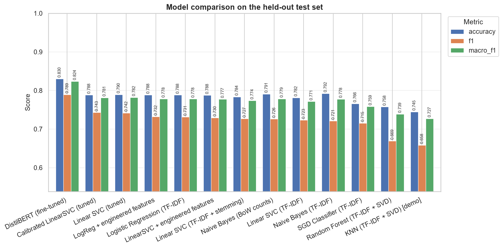
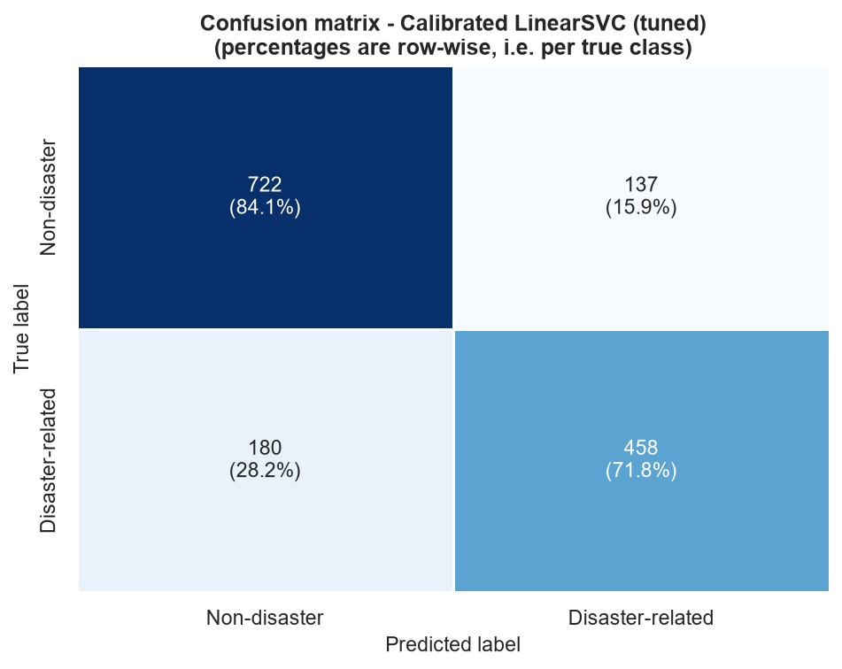
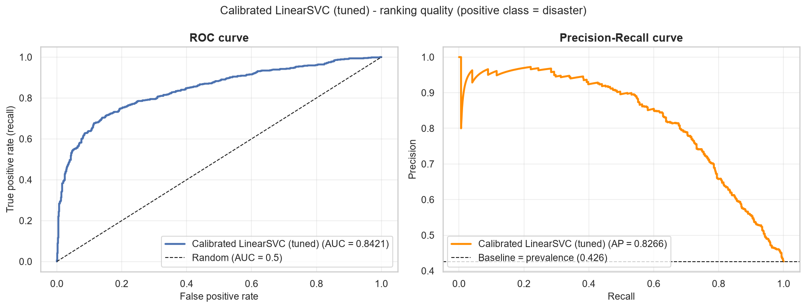

# 🌀 Digo — NLP Disaster Tweet Classification

**Project 7 | Data Science & AI Internship**

A complete Natural Language Processing pipeline that classifies tweets as **disaster-related** or **non-disaster**, with a deployed Streamlit application.

---

## Table of contents

- [Overview](#overview)
- [Problem statement](#problem-statement)
- [Objectives](#objectives)
- [Dataset](#dataset)
- [Project structure](#project-structure)
- [Environment setup](#environment-setup)
- [How to run](#how-to-run)
- [Data preprocessing](#data-preprocessing)
- [EDA findings](#eda-findings)
- [Keyword extraction and feature engineering](#keyword-extraction-and-feature-engineering)
- [Sentiment analysis](#sentiment-analysis)
- [Vectorization and embeddings](#vectorization-and-embeddings)
- [Models compared](#models-compared)
- [Results](#results)
- [Confusion matrix and error analysis](#confusion-matrix-and-error-analysis)
- [Final model selection](#final-model-selection)
- [Streamlit deployment](#streamlit-deployment)
- [Testing](#testing)
- [Known limitations](#known-limitations)
- [Future improvements](#future-improvements)
- [References](#references)

---

## Overview

During an emergency, social media is often faster than official channels. Disaster-relief
agencies and newsrooms would like to monitor it automatically — but the vocabulary of
disaster is also the vocabulary of everyday exaggeration.

| Tweet | Contains | Real disaster? |
|---|---|---|
| "Forest fire near La Ronge Sask. Canada" | *fire* | ✅ **Yes** |
| "that exam absolutely destroyed me" | *destroyed* | ❌ No |
| "My new song is FIRE 🔥" | *fire* | ❌ No |
| "13,000 people receive wildfires evacuation orders" | *wildfires* | ✅ **Yes** |

A system that searches for the word *fire* flags all four. The real task is **contextual
understanding**, which is what makes this a genuine NLP problem rather than a lookup table.

---

## Problem statement

Build a machine learning model that predicts whether a tweet refers to a real disaster
(`1`) or not (`0`), handling figurative, metaphorical and sarcastic uses of
disaster-related words.

---

## Objectives

1. Audit the supplied dataset and document every data-quality issue found.
2. Explore the data to establish what genuinely separates the two classes.
3. Build a reusable, tested preprocessing pipeline that **preserves meaning**.
4. Engineer numeric features and implement real sentiment analysis.
5. Compare multiple models fairly on an untouched test set.
6. Investigate and fine-tune DistilBERT as an advanced comparison.
7. Select a final model on evidence, save it, and verify it reloads.
8. Deploy a Streamlit application that uses the saved model.

---

## Dataset

**File:** `data/twitter_disaster.csv` — the dataset supplied with the project brief
(the Kaggle *"Natural Language Processing with Disaster Tweets"* training split).

### ⚠️ Dataset size — an honest note

> The written project statement describes **"10,000 hand-classified tweets"**.
> The dataset actually supplied contains **7,613 rows**.
>
> **This project uses the supplied 7,613 rows and nothing else.** No rows were
> synthesised, duplicated or imported from elsewhere to reach 10,000. Every statistic,
> chart, split and metric in this repository is derived from those 7,613 real rows.
> Mentor guidance was explicit that the actual supplied dataset must be used.

### Verified audit

All values below are computed from the file in notebook Section 3 — none are copied
from the brief.

| Check | Verified value |
|---|---|
| Shape | **7,613 rows × 5 columns** |
| Columns | `id`, `keyword`, `location`, `text`, `target` |
| Missing `keyword` | 61 (0.80%) |
| Missing `location` | 2,534 (33.28%) |
| Missing / empty `text` | 0 |
| Duplicate `id` | 0 |
| Duplicate `text` | 110 |
| **Texts with contradictory labels** | **18** (same text labelled both 0 and 1) |
| Distinct keywords | 221 (URL-encoded, e.g. `body%20bags`) |
| Distinct locations | 3,293 (unvalidated free text) |
| Tweet length | 7–157 characters, 1–31 words |

### Class distribution

| Label | Meaning | Count | Share |
|---|---|---|---|
| `0` | Non-disaster | 4,342 | 57.03% |
| `1` | Disaster-related | 3,271 | 42.97% |

Mild imbalance. A model that always predicts "non-disaster" scores **57.0% accuracy**
while finding zero real disasters — which is why F1 and recall are reported throughout,
never accuracy alone.

### Rows used for modelling

| Stage | Rows |
|---|---|
| Supplied file | 7,613 |
| After removing 18 contradictory texts | 7,577 |
| After removing duplicate `(text, target)` pairs | **7,485** |
| Training set (80%) | 5,988 |
| Test set (20%, untouched until final evaluation) | 1,497 |

Deduplication happens **before** the split. Had a duplicated tweet landed in both
training and test, the model would simply memorise it and the test score would be
dishonestly high.

---

## Project structure

```
Project_7_Digo/
├── data/
│   └── twitter_disaster.csv          # the supplied dataset (7,613 rows)
├── notebooks/
│   └── Project_7_Digo_NLP.ipynb      # complete end-to-end workflow, 15 sections
├── src/                              # importable logic — single source of truth
│   ├── __init__.py
│   ├── config.py                     # paths, seed, split sizes, label names
│   ├── preprocessing.py              # text cleaning (negation-preserving)
│   ├── features.py                   # 13 engineered numeric features
│   ├── sentiment.py                  # VADER + TextBlob sentiment
│   ├── modeling.py                   # sklearn pipeline factories
│   ├── evaluation.py                 # metrics, plots, error analysis
│   └── logger.py                     # optional file logging for the app
├── models/
│   ├── selected_model.joblib         # the fitted inference pipeline
│   └── model_metadata.json           # real metrics, config, versions
├── reports/
│   ├── model_comparison.csv          # every model's measured scores
│   └── figures/                      # 20 charts generated by the notebook
├── tests/
│   ├── conftest.py
│   ├── test_preprocessing.py
│   ├── test_features.py
│   ├── test_model.py
│   └── test_app_logic.py
├── logs/                             # app logs (git-ignored)
├── app.py                            # Streamlit application
├── make_presentation.py              # generates the .pptx and .md deck
├── requirements.txt                  # slim — for deployment
├── requirements-dev.txt              # full — for the notebook
├── pytest.ini
├── .gitignore
├── .env.example
├── .streamlit/config.toml
├── PROJECT_PRESENTATION.md
└── README.md
```

**Why `src/` exists.** The notebook and `app.py` both *import* this code rather than
duplicating it. The fitted pipeline references `src.preprocessing.clean_text` directly as
its vectorizer's preprocessor, so a tweet typed into the app is processed byte-for-byte
identically to the training data. A test asserts this (`test_app_logic.py`).

---

## Environment setup

**Verified on:** Windows 11, Python 3.12.7, 16-core CPU, 31 GB RAM, no CUDA GPU.

> ⚠️ On this machine `python` is 3.12.7 but `py` is 3.14.6. Use `python` (or the
> `.venv` interpreter directly) — **not** `py`.

### PowerShell — full setup from scratch

```powershell
cd "C:\DigiCrome_Bhawna_Chouhan\Internship Projects\Project 7\Project_7_Digo"

# 1. Confirm the interpreter
python --version          # expect Python 3.12.7

# 2. Create and activate the virtual environment
python -m venv .venv
.\.venv\Scripts\Activate.ps1

# 3. Upgrade pip
python -m pip install --upgrade pip setuptools wheel

# 4. Install PyTorch (CPU-only wheel — avoids a ~2.5 GB CUDA download)
pip install torch --index-url https://download.pytorch.org/whl/cpu

# 5. Install everything else
pip install -r requirements-dev.txt

# 6. Register the Jupyter kernel
python -m ipykernel install --user --name project7-digo --display-name "Python 3.12 (Project 7 Digo)"
```

If `Activate.ps1` is blocked by execution policy:

```powershell
Set-ExecutionPolicy -ExecutionPolicy RemoteSigned -Scope CurrentUser
```

### Verify the installation

```powershell
python -c "import pandas, sklearn, streamlit, torch, transformers, gensim; print('all imports OK')"
```

### For deployment only

`requirements.txt` is deliberately slim (no torch, no Jupyter) so Streamlit Community
Cloud builds quickly:

```powershell
pip install -r requirements.txt
```

---

## How to run

### Run the notebook

```powershell
.\.venv\Scripts\Activate.ps1
jupyter lab notebooks\Project_7_Digo_NLP.ipynb
```

Select the **Python 3.12 (Project 7 Digo)** kernel, then *Run All*.

Or execute it headlessly:

```powershell
.\.venv\Scripts\python.exe -m nbconvert --to notebook --execute --inplace --ExecutePreprocessor.timeout=5400 --ExecutePreprocessor.kernel_name=project7-digo notebooks\Project_7_Digo_NLP.ipynb
```

⏱️ Full runtime ≈ **21 minutes on a 16-core CPU**, dominated by the DistilBERT fine-tune (~15 min of it). That step is CPU-bound, so its wall-clock varies with machine load — runs during development took 14–21 minutes.

### Train / retrain the model

Model training happens **inside the notebook**. Running it end-to-end regenerates:

- `models/selected_model.joblib`
- `models/model_metadata.json`
- `reports/model_comparison.csv`
- `reports/figures/*.png`

Section 14 is the part that fits and saves the final model.

### Launch the Streamlit app

```powershell
.\.venv\Scripts\Activate.ps1
streamlit run app.py
```

Opens at <http://localhost:8501>.

### Run the tests

```powershell
.\.venv\Scripts\python.exe -m pytest tests\ -v
```

### Regenerate the presentation

```powershell
.\.venv\Scripts\python.exe make_presentation.py
```

---

## Data preprocessing

Implemented in [`src/preprocessing.py`](src/preprocessing.py) and used by the notebook,
the tests and the app.

> **Preprocessing ≠ feature engineering.** Preprocessing *transforms* text into a
> comparable form (throwing information away). Feature engineering *measures* the text
> (creating new information). Features must therefore be computed on the **raw** tweet —
> counting hashtags after the `#` has been stripped would always return zero.

| Step | Decision | Reasoning |
|---|---|---|
| HTML entities | Unescape twice | `&amp;` otherwise becomes the junk token `amp` |
| URLs | → `urltoken` | The address is noise, but *having a link* is signal |
| `@mentions` | → `usertoken` | The handle is noise; being a reply is signal |
| Hashtags | **Keep the word**, split CamelCase | `#CaliforniaWildfire` → `california wildfire` |
| Case | Lowercase | Capitalisation preserved numerically as `uppercase_ratio` |
| Repeated chars | `sooooo` → `soo` (letters only) | Digits excluded so `1000` survives |
| Numbers | **Keep**, including decimals | `13,000 evacuated`, `M5.8 earthquake` are meaningful |
| Stopwords | Remove — **except negation** | See below |
| Stemming | Available, **off by default** | Measured as no better (see ablation) |

### Negation is deliberately preserved

This is the single most important preprocessing decision:

```
"There is no flooding here"  →  standard cleaning  →  "flooding"     ✗ meaning inverted
"There is no flooding here"  →  our cleaning       →  "no flooding"  ✓ meaning preserved
```

The stopword set subtracts negation words, and `n't` contractions are expanded to an
explicit `not` token *before* punctuation is stripped, so TF-IDF bigrams like `not safe`
can form.

**No label leakage:** every cleaning rule is derived from the structure of tweet text.
`target` is never consulted.

---

## EDA findings

All 20 charts are in [`reports/figures/`](reports/figures/).

| Question | Answer from the data |
|---|---|
| Are classes balanced? | Mildly imbalanced, 57% / 43% |
| Does tweet length separate them? | Significantly but **weakly** — small Cohen's *d* |
| Do words separate them? | Yes — clear topical split after cleaning |
| Does `keyword` separate them? | **Strongly** — from ~8% to ~95% disaster rate |
| Do URLs help? | Yes — far more common in disaster tweets |
| Do bigrams add value? | Qualitatively yes; **measurably, no** (see ablation) |
| Is `location` useful? | No — 33% missing, 3,293 unvalidated free-text values |

**Headline conclusion:** no single feature solves this task. The signal is spread across
vocabulary, word order and structure.

### The core finding: a disaster word is not a disaster

Hundreds of **non-disaster** tweets contain explicit disaster vocabulary — *fire*,
*destroyed*, *crash*, *explosion*. Notebook Section 6.2 quantifies this per word. Terms
like *wreck* and *destroyed* sit near the ambiguous middle because they are the words
English speakers most often use figuratively, while *wreckage* and *derailment* are
nearly always literal.

A keyword-matching system would misclassify every figurative case.

---

## Keyword extraction and feature engineering

### Word frequency and discrimination

Notebook Section 6 separates two things that are often confused:

- **Frequency** — how often a word appears.
- **Discrimination** — whether a word actually distinguishes the classes.

A word can be very frequent and completely useless. Over half the vocabulary appears
exactly once, which is why the vectorizer uses `min_df=2`.

### Engineered features (13)

Computed from the **raw** tweet by [`src/features.py`](src/features.py):

`char_count`, `word_count`, `avg_word_length`, `hashtag_count`, `mention_count`,
`url_count`, `digit_count`, `exclamation_count`, `question_count`, `punctuation_count`,
`uppercase_ratio`, `stopword_ratio`, `unique_word_ratio`

**Strongest signals:** `url_count` (disaster tweets link to news) and `mention_count`
(non-disaster tweets are conversational replies). Even these are only small effect sizes —
reported honestly rather than oversold.

### Features deliberately excluded

| Column | Excluded because |
|---|---|
| `keyword` | **Curated dataset metadata.** Highly predictive here (8%→95%), but a user typing a tweet into the app has no keyword field. Training on it would inflate benchmarks and fail in production. In ~80% of rows the keyword word already appears in the tweet text, so TF-IDF recovers most of its value legitimately. |
| `location` | 33% missing, 3,293 distinct free-text values, mostly unique and inconsistent (`"USA"`, `"Worldwide"`, jokes). Thousands of sparse columns for almost no signal. |
| `id` | A row identifier — using it is a classic leakage mistake. |

---

## Sentiment analysis

Implemented in [`src/sentiment.py`](src/sentiment.py) — **actually computed**, not merely
described.

- **VADER** (primary) — built for social media: understands emoticons, slang, ALL-CAPS
  intensity and **negation**, so "not safe" scores differently from "safe". Its lexicon
  ships inside the package, so no download is needed at inference time.
- **TextBlob** (secondary) — adds a **subjectivity** score, which VADER lacks.

### Sentiment is a different question from disaster classification

| Tweet | Sentiment | Disaster? |
|---|---|---|
| "7.8 magnitude earthquake strikes Nepal" | neutral (factual) | ✅ Yes |
| "This traffic is killing me" | very negative | ❌ No |
| "Relief teams arrived, everyone is safe now!" | positive | ✅ Yes |

**Measured result:** disaster tweets *are* more negative and more objective, but the
correlations are weak — and a **sentiment-only rule performs worse than guessing the
majority class**. So sentiment is used as a supporting signal only.

The app displays sentiment **separately** from the prediction, with the distinction
explained in the UI.

---

## Vectorization and embeddings

Notebook Section 9 distinguishes four concepts that are frequently conflated — and none
of them is label encoding:

| Concept | What it does | Context-aware? |
|---|---|---|
| **Tokenization** | Splits text into units | n/a |
| **Bag of Words** | Counts tokens per document | No |
| **TF-IDF** | Weights counts by rarity across the corpus | No |
| **Word embeddings** | Maps each *word* to a dense learned vector | **No** |
| **Contextual embeddings** | Vector depends on the whole sentence | **Yes** |

> Label encoding (`red=0, green=1`) is for *categorical* variables. Applied to words it
> would claim word #7 is "less than" word #8 — meaningless. Vectorization instead
> produces one dimension per term, or a learned semantic space.

**Word2Vec** was trained on the project's own corpus rather than downloading pretrained
vectors. The alternatives were checked first:

| Option | Download | Decision |
|---|---|---|
| GloVe 6B | ~822 MB | Rejected — cannot ship to Streamlit Cloud |
| `word2vec-google-news-300` | ~1.6 GB | Rejected — 3.6 GB in RAM |
| `glove-twitter-25` | ~104 MB | Reasonable, but an external dependency |
| **Trained on our corpus** | **0 MB** | ✅ Chosen — reproducible, no download |

The learned space correctly groups related disaster terms. Its **limitation** is the
reason DistilBERT follows: Word2Vec gives *fire* a single fixed vector regardless of
whether it appears in "forest fire" or "my song is fire" — and distinguishing exactly
that is the whole task.

---

## Models compared

| Model | Why included |
|---|---|
| Majority-class baseline | The floor any real model must beat |
| Multinomial Naive Bayes (BoW counts) | Classic text baseline |
| Multinomial Naive Bayes (TF-IDF) | Same model, different weighting |
| Logistic Regression | Strong linear baseline, native probabilities |
| Linear SVC | Usually best linear model for sparse text |
| SGD Classifier | Different optimiser, scales to large corpora |
| Random Forest + SVD | Tests a non-linear model fairly |
| LinearSVC / LogReg + engineered features | Tests whether Sections 7–8 features help |
| Linear SVC + stemming | Preprocessing ablation |
| Linear SVC (tuned) | `GridSearchCV`, training folds only |
| **Calibrated LinearSVC (tuned)** | **Selected** — adds real probabilities |
| KNN + SVD *(demo)* | Included to **demonstrate** unsuitability |
| **DistilBERT (fine-tuned)** | Advanced transformer comparison |

> **On Random Forest and KNN with sparse text.** Mentor guidance warned against forcing
> tree and distance models onto sparse text, and the results confirm it. Both are
> included *fairly* (on SVD-reduced dense features) so the warning is backed by evidence
> rather than assertion. KNN is explicitly labelled a demonstration, not a candidate.

### Leakage prevention

| Leak | Prevented by |
|---|---|
| Duplicate tweets in both splits | Removed before splitting |
| Vectorizer vocabulary built on test data | `TfidfVectorizer` lives **inside** the `Pipeline` |
| Scaler statistics from test data | `StandardScaler` inside the same pipeline |
| Tuning against the test set | All tuning uses `cross_val_score` on `X_train` only |
| Target used as a feature | `y` kept entirely separate from `X` |
| Cleaning rules derived from labels | Rules are structural; `target` never consulted |

---

## Results

All figures below are measured on the **1,497-row held-out test set**,
which was not used for training, tuning or model selection. They are read directly from
[`models/model_metadata.json`](models/model_metadata.json) and
[`reports/model_comparison.csv`](reports/model_comparison.csv), both written by the notebook.

| Model | Accuracy | Precision | Recall | F1 | Macro-F1 | ROC-AUC | CV F1 |
|---|---|---|---|---|---|---|---|
| DistilBERT (fine-tuned) ⬅ best overall | 0.8303 | 0.8380 | 0.7461 | **0.7894** | 0.8237 | 0.8897 | — |
| Calibrated LinearSVC (tuned) ⬅ **deployed** | 0.7882 | 0.7697 | 0.7179 | **0.7429** | 0.7814 | 0.8421 | 0.7611 |
| Linear SVC (tuned) | 0.7896 | 0.7770 | 0.7100 | **0.7420** | 0.7822 | 0.8387 | 0.7611 |
| LogReg + engineered features | 0.7882 | 0.7945 | 0.6787 | **0.7320** | 0.7785 | 0.8455 | 0.7611 |
| Logistic Regression (TF-IDF) | 0.7882 | 0.7967 | 0.6755 | **0.7311** | 0.7782 | 0.8411 | 0.7564 |
| LinearSVC + engineered features | 0.7876 | 0.7974 | 0.6724 | **0.7296** | 0.7773 | 0.8413 | 0.7619 |
| Linear SVC (TF-IDF + stemming) | 0.7836 | 0.7865 | 0.6755 | **0.7268** | 0.7738 | 0.8430 | 0.7551 |
| Naive Bayes (BoW counts) | 0.7909 | 0.8218 | 0.6505 | **0.7262** | 0.7785 | 0.8222 | 0.7487 |
| Linear SVC (TF-IDF) | 0.7816 | 0.7864 | 0.6693 | **0.7231** | 0.7714 | 0.8377 | 0.7576 |
| Naive Bayes (TF-IDF) | 0.7923 | 0.8428 | 0.6301 | **0.7211** | 0.7778 | 0.8364 | 0.7432 |
| SGD Classifier (TF-IDF) | 0.7662 | 0.7432 | 0.6897 | **0.7154** | 0.7585 | 0.8193 | 0.7376 |
| Random Forest (TF-IDF + SVD) | 0.7575 | 0.7996 | 0.5752 | **0.6691** | 0.7389 | 0.8052 | 0.6978 |
| KNN (TF-IDF + SVD) [demo] | 0.7448 | 0.7667 | 0.5768 | **0.6583** | 0.7273 | 0.7936 | 0.6752 |
| Baseline (majority class) | 0.5738 | 0.0000 | 0.0000 | **0.0000** | 0.3646 | 0.5000 | 0.0000 |



### What the comparison shows

1. **Every real model beats the majority-class baseline** (57.4% accuracy, 0.000 F1) —
   the task is learnable.
2. **Linear models dominate the classical field.** With ~30,000 sparse features and
   5,988 training rows, a regularised linear boundary generalises well.
3. **Random Forest (0.6691 F1) and KNN
   (0.6583 F1) underperform** despite costing far more to
   train, confirming the mentor's warning about tree and distance-based models on sparse
   text — with evidence rather than assertion.
4. **DistilBERT is genuinely the best model** at 0.7894 F1
   (**+0.0465** vs the deployed model, **+4.2%** accuracy).
5. **Engineered features and preprocessing variants changed almost nothing.** Two honest
   negative results, reported rather than hidden.

### On the accuracy level reached

The classical models land around **78–79% accuracy / ~0.74 F1**, and DistilBERT at
**83.0% / 0.7894**. This is the realistic range for this dataset, and it is
worth stating plainly:

- **18 texts were labelled both ways by human annotators** (Section 3.3). Some error is
  built into the labels themselves.
- Tweets are short — ~15 words on average — so there is little text to work with.
- Published results on this dataset cluster in the same range, with the upper end
  requiring large transformer models.

A model reporting 95%+ here would be strong evidence of **data leakage**, not of skill.

---

## Confusion matrix and error analysis



| | Predicted non-disaster | Predicted disaster |
|---|---|---|
| **Actually non-disaster** | 722 ✅ | 137 ❌ false alarms |
| **Actually disaster** | 180 ❌ **missed** | 458 ✅ |

**Read operationally:**

- Of **638 real disasters** in the test set, the model found **458
  (71.8%)** and **missed 180 (28.2%)**.
- Of the **595 disaster alerts** it raised, **458 (77.0%)** were correct
  and **137** were false alarms.

The two error types are not equally costly. False negatives are missed emergencies — the
dangerous failure for a monitoring tool. False positives waste responder attention and,
in volume, cause alarm fatigue. Notebook Section 13.4 provides the full threshold
trade-off table for tuning this balance.



ROC-AUC **0.8421**, average precision **0.8266**
(chance baseline = 0.4262).

### Where the model fails

Reading the actual false positives and false negatives (notebook Section 13.1), the
failures fall into recognisable groups:

- **Genuinely ambiguous tweets** — many would be hard for a human too.
- **Flat news headlines** without emotive words.
- **Figurative use of literal disaster words** — the core difficulty.
- **Very short tweets** — little for TF-IDF to work with.

> **Caveat.** Not every "error" is the model's fault. Some test labels are themselves
> debatable — recall that human annotators disagreed on 18 texts. Claiming the model is
> wrong in all these cases would overstate what the ground truth establishes.

### Contextual probe set

Notebook Section 13.2 runs a **hand-written** probe set covering clear disasters, clear
non-disasters, figurative language, negation, URL/hashtag-heavy tweets, and very short
and long tweets.

These probes are kept **strictly separate** from the quantitative test set — mixing
self-labelled examples into official metrics would corrupt them.

For genuinely ambiguous probes such as **"The forest got destroyed"** and
**"The children fired the stage"**, no ground-truth label is asserted. Without further
context these are undecidable: the first could describe real wildfire damage or be
hyperbole about a video game. The model's output and confidence are recorded and
discussed instead. An ambiguous example tests *calibration*, not *accuracy*.

---

## Final model selection

**Selected: `Calibrated LinearSVC (tuned)`**
— `TF-IDF + CalibratedClassifierCV(LinearSVC)`

| Criterion | Value |
|---|---|
| Test F1 (disaster class) | **0.7429** |
| Test accuracy | 0.7882 |
| Macro-F1 / Weighted-F1 | 0.7814 / 0.7871 |
| ROC-AUC | 0.8421 |
| Cross-validated F1 (train only) | 0.7611 ± 0.0162 |
| Artifact size | **1.05 MB** |
| Inference speed | 0.031 ms per tweet |
| Probability output | Calibrated (sigmoid, 5-fold) |

**Configuration:** TF-IDF with `ngram_range=(1, 2)`,
`min_df=1`, `max_features=30,000`,
`sublinear_tf=True`, vocabulary of 30,000 terms;
`LinearSVC(C=1.0)` wrapped in `CalibratedClassifierCV`.
Hyperparameters chosen by `GridSearchCV` on the training folds only.

### Why not DistilBERT?

This deserves a straight answer, because **DistilBERT is the better model**:

| | Deployed model | DistilBERT |
|---|---|---|
| F1 (disaster) | 0.7429 | **0.7894** (+0.0465) |
| Accuracy | 0.7882 | **0.8303** (+0.0421) |
| ROC-AUC | 0.8421 | **0.8897** |
| Artifact size | **1.05 MB** | ~255 MB |
| Training time | 0.9 s | ~15 min (CPU) |
| Inference | **0.131 ms** | 20.7 ms (159x slower) |

The transformer wins on quality. It is **not deployed** because ~255 MB exceeds GitHub's
100 MB per-file limit (requiring Git LFS or a runtime download) and inference is
159x slower on Streamlit Community Cloud's free tier.

**This is a documented trade-off, not a claim that the models are equivalent.** The
notebook reports DistilBERT's real fine-tuning run (2 epochs,
lr=3e-05, batch=32, max_len=64,
15.0 minutes on CPU) in full.

### ⚠️ A measured weakness: negation defeats *both* models

Notebook Section 13.2.1 runs both models over the same contextual probe set. This
produced the most instructive result in the project, and it is reported as it came out
rather than as expected.

| Probe | Deployed model | DistilBERT |
|---|---|---|
| "This traffic is killing me, I've been stuck for an hour" | ❌ *Disaster* (0.701) | ✅ *Non-disaster* (0.381) |
| "There is no flooding in our area, everything is fine" | ❌ *Disaster* (0.854) | ❌ *Disaster* (**0.915**) |
| "The fire alarm was a false alarm, nothing happened" | ❌ *Disaster* (0.819) | ❌ *Disaster* (0.550) |

Scores on the unambiguous probes: **TF-IDF 10/13, DistilBERT 11/13**; on the
figurative/negation subset specifically, **3/6 vs 4/6**.

**What the transformer fixed — figurative language.** "This traffic is killing me" goes
from a confident wrong answer to a correct one. *Killing* in the context of *traffic* is
read differently from *killing* in a news report, which a bag of weighted terms cannot
represent.

**What it did not fix — negation.** Both models still call "There is no flooding in our
area" a disaster, and DistilBERT does so *more* confidently. Having the architectural
capacity to represent negation is clearly not the same as having learned to use it.

The likely cause is the **training data, not the architecture**. Disaster vocabulary
appears in ~3,000 training tweets, nearly all genuine reports; explicitly *negated*
disaster statements are rare. Both models therefore learn a strong lexical prior —
"flooding implies disaster" — that two epochs of fine-tuning cannot overturn for a
construction that barely appears.

Note that preprocessing **does** preserve negation: `"There is no flooding here"` survives
cleaning as `no flooding`, not `flooding`. Preserving the token was **necessary but not
sufficient**. Fixing this properly would require training data containing negated
examples — which is why it is the top item under
[Future improvements](#future-improvements), and why it is listed as a real limitation in
the app's own UI.

### Artifacts saved

- [`models/selected_model.joblib`](models/) — the complete fitted pipeline
  (vectorizer + calibrated classifier), 1.05 MB
- [`models/model_metadata.json`](models/) — real metrics, full configuration, random
  seed, dataset description, package versions, training timestamp

After selection the model was refitted on all 7,485
deduplicated rows for production. **The reported metrics remain the held-out test metrics
above** — the refitted model is never re-scored on data it has now seen.

Notebook Section 14.4 reloads the saved artifacts and asserts predictions are identical,
and [`tests/test_model.py`](tests/test_model.py) repeats that check in a **fresh Python
process** with no notebook state.

---

## Streamlit deployment

### Local

```powershell
.\.venv\Scripts\Activate.ps1
streamlit run app.py
```

### The app

**Layout**

- Branded hero header with project and programme chips, on a dark theme
  (`.streamlit/config.toml`).
- Three introductory panels — **👩‍🎓 About Me**, **📌 About the Project**,
  **🎯 Project Overview** — giving the author's background, the problem framing
  (with the *fire* / *destroyed* contrast table) and the workflow summary.
- Sidebar: model card, live performance metrics, dataset summary, author block and a
  safety notice.

**Classifier**

- Loads the saved model via `@st.cache_resource` — **never retrains**.
- Text area with live character counter, plus five one-click example tweets
  (clear disaster, figurative, negation, ambiguous, everyday chat).
- Colour-coded result card — red for disaster, green for non-disaster — with a
  plain-English explanation of what the verdict means.
- Shows a **calibrated probability**, with a low-confidence warning when the tweet
  sits near the decision boundary.
- Prediction detail in two tabs:
  - *How the model read this* — the **cleaned text** the model actually sees, plus
    five measured properties (words, characters, hashtags, mentions, links).
  - *Sentiment (separate)* — VADER tone and TextBlob subjectivity, with the
    difference from the prediction explained so the two are never confused.

**Transparency**

- **Every figure is read live from `models/model_metadata.json`** — accuracy, F1,
  dataset counts, vocabulary size, artifact sizes and the DistilBERT comparison.
  Nothing is hardcoded, so the UI cannot drift from the trained model.
- A **model comparison panel** showing the deployed model against the fine-tuned
  DistilBERT, stating plainly that the transformer is the better model and is
  excluded only on size and speed grounds.
- A **limitations panel** that documents the negation weakness explicitly.
- Input validation, friendly error messages, no tracebacks, no debug output.
- Optional prediction logging to `logs/` (no personal data collected).

**Editing the author details.** The `STUDENT` dictionary at the top of
[`app.py`](app.py) holds the name, qualification, role, programme and optional
`github` / `linkedin` / `email` links. Fill a link in and a *Connect* line appears in
the About Me panel; leave it blank and nothing is shown.

### Deploying to Streamlit Community Cloud

1. Push this repository to GitHub (see below).
2. Go to <https://share.streamlit.io> and sign in with GitHub.
3. **New app** → select your repository and branch.
4. Set **Main file path** to `app.py`.
5. Under *Advanced settings*, set **Python version** to **3.12**.
6. Click **Deploy**.

**Deployment checklist — all verified:**

| Requirement | Status |
|---|---|
| Entry point is `app.py` at the repo root | ✅ |
| `requirements.txt` is slim (no torch/Jupyter) | ✅ |
| Model artifact committed and under 100 MB | ✅ **1.05 MB** |
| Dataset committed and under 100 MB | ✅ 0.95 MB |
| No Windows absolute paths — all via `pathlib` | ✅ |
| No `nltk.download()` at runtime | ✅ vendored stopwords |
| Sentiment lexicons bundled in their packages | ✅ |
| Logging degrades gracefully on read-only filesystems | ✅ |
| No secrets committed | ✅ |

> **Note.** The app is **not currently deployed publicly.** The configuration above has
> been prepared and verified locally, but no public URL exists. Deploy it yourself with
> the steps above.

### Pushing to GitHub

```powershell
cd "C:\DigiCrome_Bhawna_Chouhan\Internship Projects\Project 7\Project_7_Digo"

git init
git add .
git commit -m "Digo: NLP disaster tweet classification"
git branch -M main
git remote add origin https://github.com/<your-username>/<your-repo>.git
git push -u origin main
```

Check what will be committed before pushing:

```powershell
git status --short
```

`.venv/`, `logs/`, caches, secrets and transformer weights are all git-ignored. The
~1 MB model and the ~1 MB dataset **are** committed deliberately, because the deployed
app needs them.

---

## Testing

```powershell
.\.venv\Scripts\python.exe -m pytest tests\ -v
```

**Actual result — 156 passed in 4.61s**

```
156 tests passed across 4 test files
tests/test_preprocessing.py  ·  tests/test_features.py
tests/test_model.py          ·  tests/test_app_logic.py
```


**What is covered:**

| Area | Examples |
|---|---|
| Text cleaning | URLs, mentions, hashtags, HTML entities, repeated characters |
| Edge cases | `None`, `NaN`, empty strings, punctuation-only, non-string types |
| **Negation preservation** | `"no flooding"` keeps `no`; `"don't"` → `not` |
| Numbers | `13,000` → `13000`; `M5.8` keeps its decimal; `1000` not squashed |
| Features | Counts verified against hand-computed values |
| Sentiment | Ranges, negation handling, label thresholds |
| Model loading | Fitted state, artifact size, deterministic predictions |
| Label mapping | Probability agrees with predicted class |
| **Train/inference consistency** | Asserts the saved pipeline uses `src.preprocessing.clean_text` |
| Missing artifacts | Missing and corrupt model/metadata files handled gracefully |
| App logic | Validation and prediction tested without the UI |

---

## Known limitations

- **Negated statements are misclassified.** "There is no flooding in our area" is read as
  a disaster by the deployed model *and* by DistilBERT. This is a measured weakness of the
  delivered system, not a hypothetical one — see
  [the probe comparison](#️-a-measured-weakness-negation-defeats-both-models).
- **Not an emergency service.** It classifies *language*; it cannot verify that an event
  actually happened. Never rely on it for safety decisions.
- **English only.** No Hindi, Marathi or Gujarati support is implemented — and therefore
  none is claimed.
- **2015-era vocabulary.** Slang, hashtags and events have moved on.
- **Sarcasm and irony remain hard** — the known weak point.
- **Short inputs are unreliable.** A one-word tweet gives the model very little.
- **Irreducible label noise.** Human annotators disagreed on 18 identical tweets.
- **No disaster-type detection.** The dataset has no reliable type label, so the project
  does not claim to identify *which kind* of disaster.
- **Single source.** Metrics may not transfer to other platforms or time periods.

---

## Future improvements

Ordered by what the evidence in this project suggests would help most:

1. **Fix negation** — the clearest concrete weakness found. Augment the training set with
   negated variants of disaster tweets ("no flooding", "false alarm", "turned out to be
   nothing"). The probe comparison indicates the barrier is *missing training examples*,
   not model capacity, since DistilBERT fails these too.
2. **Train DistilBERT longer and on more data** — two epochs on 5,088 tweets is modest.
3. Evaluate on a modern, independently labelled tweet sample.
4. Deploy DistilBERT behind an API where its size is not a constraint.
5. Add explainability (SHAP, or per-token coefficient attribution) to the app.
6. Tune the decision threshold to a specific operational cost balance
   (notebook Section 13.4 provides the trade-off table).

---

## References

**Dataset**
- *Natural Language Processing with Disaster Tweets*, Kaggle.
  <https://www.kaggle.com/competitions/nlp-getting-started>
  Supplied with the project brief as `twitter_disaster.csv`.

**Models and tools**
- Sanh, V. et al. (2019). *DistilBERT, a distilled version of BERT: smaller, faster,
  cheaper and lighter.* <https://arxiv.org/abs/1910.01108>
- DistilBERT model card. <https://huggingface.co/distilbert/distilbert-base-uncased>
- Hutto, C.J. & Gilbert, E. (2014). *VADER: A Parsimonious Rule-based Model for
  Sentiment Analysis of Social Media Text.* ICWSM-14.
- Mikolov, T. et al. (2013). *Efficient Estimation of Word Representations in Vector
  Space.* <https://arxiv.org/abs/1301.3781>
- Pedregosa, F. et al. (2011). *Scikit-learn: Machine Learning in Python.* JMLR 12.

**Libraries**
- scikit-learn, pandas, NumPy, SciPy, Matplotlib, seaborn, NLTK, TextBlob,
  vaderSentiment, gensim, PyTorch, Hugging Face Transformers, Streamlit, pytest.

---

## Acknowledgements

Built as Project 7 of a Data Science & AI internship, following the official project
statement and four mentor guidance sessions.

**Author:** Bhawna Chouhan
